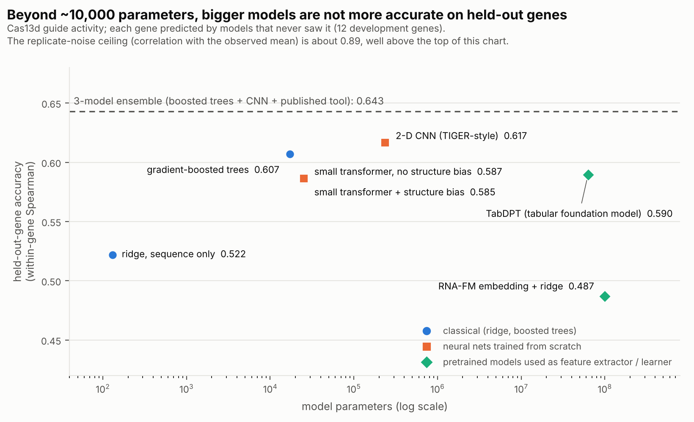

# guidefam — a small model family for RNA-guided knockdown, evaluated leak-free

Two members share one data/evaluation harness:

| member | task | data (fetched from the authors' public repos at run time) | what it is |
|---|---|---|---|
| `cas13d` | Cas13d guide on-target activity | TIGER HEK293T screen (9,985 perfect-match guides, 16 genes), flow-cytometry (CD46/CD55/TFRC), HAP1 (1,082 genes) | LightGBM + a PyTorch Tiger2D re-implementation + the "Konermann" 30-mer model's scores, rank-averaged within gene |
| `sirna` | siRNA efficacy | OligoFormer tables (Huesken 2,361; Mixset 472; Takayuki 702) | ridge + LightGBM on sequence, thermodynamic descriptors, rule scores, target flanks |

**Status (see `RESULTS.md` for every number and caveat):** Cas13d shows a real, replicated gain over our re-implementation of TIGER's network (+0.026 within-gene Spearman, 16/16 genes, confirmed on 4 genes locked away from development). siRNA is at parity with OligoFormer (Huesken -> Mixset AUC 0.813 vs 0.816, PCC 0.574 vs 0.588), not better. Eight other ideas were tried and did not help; they are listed so nobody repeats them.

This is a family of *task models* sharing a protocol, not a pretrained foundation model. RNA-FM embeddings and a pretrained tabular model (TabDPT) were tested and are optional extras, not part of the headline models.



## Why the protocol matters here
Guides tile each transcript one nucleotide apart, so neighbouring guides share 22 of 23 nucleotides and similar activity. Every split is by gene / target, every normalisation uses training rows only, and the headline metric (within-gene Spearman) cannot be inflated by between-gene differences. Two published evaluation recipes were audited and found to flatter scores (`PROTOCOL.md` section 6).

## Layout
```
guidefam/
  data.py  features.py  structure.py  lm.py  sirna.py        data loading, features (structure/lm/TabDPT are optional and did not help)
  cv.py  metrics.py  comparators.py  tiger_torch.py            leave-one-gene-out, metrics + block bootstrap, published-tool scores, Tiger2D port
  pairformer.py                                                 MiniPairFormer: 25k-parameter transformer with an RNA-structure attention bias (ablation: no gain)
  official_tiger.py                                             the authors' released TIGER weights as a PyTorch forward pass (export them yourself; licence)
  safepickle.py                                                 loads TIGER's pickles through an exact allowlist (refuses anything else)
  scripts/   run_all.sh  final_cas13d.py  final_sirna.py  m4_extend.py  sirna_plus_oligoformer.py  audit_*.py  dev_*.py  sirna_dev*.py  ...
  scripts/noise_vs_information.py feature_discovery.py residual_correction.py mismatch_task.py    round-3 diagnostics and the mismatch-tolerance task (RESULTS.md section 9)
  mismatch.py                                                   variant-guide features for the mismatch-tolerance task
  tests/test_basic.py                                           invariants (orientation, label conventions, hostile-pickle refusal, normalisation leakage)
  results/                                                      small raw outputs behind RESULTS.md
  PROTOCOL.md  RESULTS.md  RUN_ON_M4.md
```

## Quick start
```bash
python -m venv .venv && source .venv/bin/activate
pip install -r guidefam/requirements.txt
SKIP_TIGER=1 bash guidefam/scripts/run_all.sh ~/guidefam_work      # ~15 min, no neural baseline
bash guidefam/scripts/run_all.sh ~/guidefam_work                    # + Tiger2D leave-one-gene-out (~1-2 h) and the final tables
```
Then read `RUN_ON_M4.md` for the longer stages.

## Licences and provenance
**Read `RESULTS.md` section 7.** TIGER is academic / non-commercial only; OligoFormer is proprietary (no modification, redistribution or competing use) and nothing from it is run or ported here.

Third-party data and prediction files are not redistributed here: `run_all.sh` clones `daklab/tiger` and `lulab/OligoFormer` and reads them. Check their licences before reusing their data. TabPFN (not used for any reported number) needs a personal licence acceptance at Prior Labs; TabDPT (used in one neutral test) ships open safetensors weights. No code from the cloned repositories is executed; their pickles are read through `safepickle.py`.
